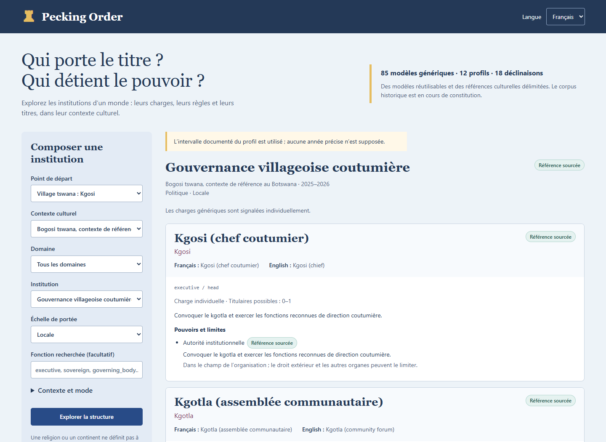

# Pecking Order

**Qui porte le titre ? Qui détient le pouvoir ?** Une base de connaissances autonome
pour les institutions, les fonctions et les titres culturels de vos mondes.

[English](README.en.md) · [Contrat](docs/contract.fr.md) · [Conception](docs/design.fr.md) ·
[Couverture](docs/coverage.md) · [Sources](PROVENANCE.md)

Pecking Order fournit les structures que **Lineage Lab** peut peupler et que
**Magna Urbis** peut situer. **Namebench** fournit les noms de leurs titulaires.
Aucune dépendance entre ces projets : échanges par identifiants et JSON.



Le socle livré comprend **85 modèles génériques**, **12 profils culturels**,
**18 déclinaisons documentées** et **12 sources**. Les titres, fonctions, missions,
pouvoirs et règles sont disponibles en **français et en anglais**, avec le titre
d’origine lorsqu’il est renseigné. Les clés de langue sont extensibles.
La taxonomie est large ; le corpus historique initial ne prétend pas couvrir toutes
les cultures ni toute leur histoire.

## Lancer l’explorateur

Python 3.12 ou ultérieur. Sous Windows, double-cliquer sur **`demo.cmd`**, puis ouvrir
**http://127.0.0.1:8773**. Ou :

```powershell
python -m venv .venv
.venv\Scripts\python.exe -m pip install -e ".[dev]"
.venv\Scripts\python.exe -m pecking_order studio
```

Sur Linux/macOS, utiliser `.venv/bin/python`. Le serveur écoute uniquement sur la
boucle locale. Il fonctionne sans LLM, clé d’API, base externe ni autre dépôt.

L’explorateur propose des exemples, le passage FR/EN, la consultation des pouvoirs,
des relations et des sources, ainsi que l’import/export des requêtes et des résultats.

## Poser une question

```json
{
  "culture": "tswana_bogosi_contemporary",
  "organization": {"kind": "village_council", "scale": "local"},
  "role": "executive",
  "locale": "fr"
}
```

Résultat : une charge **Kgosi**, rendue par *chef coutumier / chief*, avec ses
fonctions documentées, le forum **Kgotla**, la structure complète et les sources.
Le rôle demandé sélectionne les charges à afficher ; il ne retire pas leur contexte.

```python
from pecking_order import KnowledgeBase

kb = KnowledgeBase()
result = kb.resolve({
    "culture": "huf",
    "organization": {"kind": "corporate_household", "scale": "household"},
    "role": "household_manager",
})
print(result.display["manager.title"])  # Karta (gestionnaire familial)
```

```powershell
.venv\Scripts\python.exe -m pecking_order resolve examples/tswana-village.json
.venv\Scripts\python.exe -m pecking_order catalog
.venv\Scripts\python.exe -m pecking_order validate
```

HTTP : `GET /api/catalog`, `GET /api/sources`, `POST /api/resolve`.
Les [schémas JSON](schemas/) et le [contrat OpenAPI](schemas/openapi.json) sont versionnés.

## Les distinctions qui comptent

- **Fonction, titre, grade et personne** sont distincts. Le commandant d’un corps
  britannique peut porter le grade de *Lieutenant General* ; le grade n’est pas la fonction.
- **Le contexte fait le titre.** « Hindou » appelle une précision. Le *Raya* de
  Vijayanagara et le *Sultan* d’une cour du Deccan ne se déduisent pas d’un simple
  paramètre « autoritaire ». « Africain » ne détermine pas un chef universel.
- **Un groupe peut avoir plusieurs centres de pouvoir.** Conseil, chefferie,
  autorité rituelle, patrimoine et nomination ne forment pas toujours un arbre.
- **Un titre sourcé ne rend pas tous ses pouvoirs historiques.** Chaque titre,
  pouvoir, relation et règle porte son propre statut de preuve.
- **Les familles ne sont présentes que comme institutions particulières** : maison
  noble, lignage organisé, clan, famille indivise, maison matrilinéaire, dynastie ou
  alliance entre maisons. Pas de modèles triviaux « père / mère / enfants ».

Le mode `historical` exige une déclinaison culturelle documentée ; `inspired`
autorise une adaptation explicite ; `generic` exige `culture: "*"`. Une donnée
absente produit un diagnostic, jamais un titre culturel inventé.

Pour une monarchie fictive inspirée de Vijayanagara mais rendue autoritaire, voir
[cet exemple](examples/authoritarian-raya.json). Les adaptations ne sont pas
acceptées en mode historique et ne transforment jamais leur pouvoir fictif en fait sourcé.

## Vérifier et enrichir

```powershell
.venv\Scripts\python.exe -m pytest
.venv\Scripts\ruff.exe check src tests tools
.venv\Scripts\python.exe tools/build_catalog.py
.venv\Scripts\python.exe tools/export_schemas.py
.venv\Scripts\python.exe -m build
# Tests navigateur facultatifs, après lancement du serveur :
.venv\Scripts\python.exe -m pip install -e ".[browser]"
.venv\Scripts\python.exe tools/check_browser.py
```

La base distribuée est [catalog.json](src/pecking_order/data/catalog.json), construite
depuis [le catalogue éditorial](tools/build_catalog.py). Un fichier personnalisé se
charge avec `pecking-order --data chemin/catalog.json …` ou `KnowledgeBase(path)`.
Il doit être complet et validé avant tout service de requêtes. Voir
[le guide de contribution](docs/authoring.fr.md) et [l’intégration](docs/integration.fr.md).
