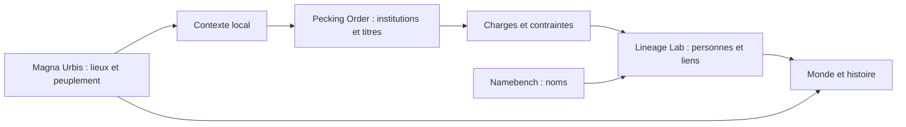

# Conception : une grammaire des institutions

## Place dans l’écosystème

Le document `worldbuilder_social_engine_study.md`, retrouvé dans
`ttrpg_content_generator`, décrit un moteur social complet : population, parenté,
réseaux, organisations, règles et histoire. Pecking Order extrait le référentiel
institutionnel réutilisable de cet ensemble. Le document d’origine est archivé
[ici](reference/worldbuilder_social_engine_study.md).

Le produit répond à « comment ce groupe est-il organisé, comment nomme-t-on ses
charges et que peuvent-elles faire ? ». Il ne décide pas quel individu est roi,
combien de personnes vivent dans une ville ni quelle dynastie gagnera une guerre.

La base et la bibliothèque Python fonctionnent hors ligne. Une application Rust,
WASM ou TypeScript peut consommer les mêmes schémas JSON et résultats HTTP, ou
précompiler un ensemble de résultats dans ses propres assets. Aucun port ni
service externe n’est imposé au monde généré.

## Unité de connaissance

Une **fonction** est un besoin institutionnel : décision, représentation, gestion
du patrimoine, justice, rituel, logistique ou transmission. Une **charge** est une
position définie dans une institution. Le **titre** désigne culturellement cette
charge. Le **grade** exprime une position dans un système de grades distinct.
La **personne** ou l’organe titulaire appartient au monde consommateur.

Cette séparation évite de traiter `king`, `roi`, `Raya`, `Sultan` et `Asantehene`
comme des synonymes interchangeables. Ils peuvent être associés à une fonction
comparable dans un contexte précis, sans porter les mêmes compétences, les mêmes
critères d’accès ni la même autorité.

L’organisation est un graphe : charges, relations typées, règles et sous-unités.
Il peut exister un souverain nominal, un gouvernant effectif, un conseil, une
autorité rituelle et un organe qui nomme ou révoque le gouvernant. Un organigramme
de commandement est une projection de ce graphe, pas son modèle universel.

## Réutilisation et exceptions

Le catalogue éditorial compose des fonctions réutilisables dans 85 modèles
institutionnels. Il matérialise le résultat en JSON lisible sans le code Python.
Une déclinaison culturelle remplace des charges entières, en ajoute, en retire ou
remplace explicitement les relations. Aucun mélange implicite entre cultures.
Les titres d’une culture ne se propagent pas à toutes les autres institutions de
cette culture par ressemblance de vocabulaire.

Le modèle générique dit « il peut y avoir une administration et une trésorerie ».
La déclinaison dit « dans ce contexte documenté, cette charge porte ce titre et
dispose de cette compétence ». L’absence de source maintient le statut générique.
Une exception devient une règle explicite plutôt qu’un `if culture == ...` enfoui
dans le résolveur. L’exception du Tadodaho dans le profil haudenosaunee en fournit
un exemple, sans prétendre modéliser toutes les procédures de la Confédération.

Les adaptations autoritaire, élective et dynastique sont des transformations
bornées pour le worldbuilding. Elles ne constituent pas une grammaire universelle
de toutes les réformes politiques. Les autres changements nécessitent un profil
ou modèle éditorial nouveau et vérifiable.

## Inventaire des dimensions à documenter

La couverture d’un système institutionnel doit examiner les dimensions suivantes.
Le schéma peut les porter sous forme de charges, pouvoirs, règles et relations ;
la présence d’un champ ne signifie pas qu’un profil est déjà renseigné sur ce point.

| Dimension | Questions à traiter |
|---|---|
| Identité | Type de groupe, finalité, nom de l’institution, nom collectif de ses membres |
| Contexte | Région, époque, tradition politique, tradition religieuse, langue, milieu et classe sociale |
| Portée | Maison, localité, district, région, entité politique, empire, réseau transrégional |
| Composition | Charges individuelles, collèges, membres, initiés, apprentis, groupes constituants |
| Pouvoir | Commandement, budget, ressources, justice, norme, rituel, diplomatie, admission |
| Limites | Territoire, domaine, délégation, consentement, veto, contrôle, autorité externe |
| Accès | Élection, nomination, cooptation, ancienneté, initiation, examen, achat, descendance, tirage au sort |
| Éligibilité | Appartenance, formation, statut, âge institutionnel, parenté, conditions explicites de genre ou d’espèce |
| Mandat | Durée, vie, rotation, renouvellement, cumul, intérim, régence, absence et vacance |
| Sortie | Décès, démission, destitution, révocation, exclusion, déposition, dissolution |
| Succession | Ordre successoral, choix dans un groupe admissible, conflit, validation, régence |
| Patrimoine | Propriété commune ou individuelle, gestion, partage, transmission, usufruit et fiducie |
| Parenté organisée | Filiation, adoption, résidence, alliances, exogamie et continuité d’une maison |
| Relations | Subordination, représentation, fédération, affiliation, patronage, contrôle et légitimation |
| Langue | Titre d’origine, translittération, traduction, équivalent de fonction, formes grammaticales et d’adresse |
| Preuve | Auteur, source, emplacement, portée, limites, date de consultation et statut de chaque affirmation |

Les règles v1 peuvent déclarer ces dimensions ; elles ne constituent pas encore
un calculateur général de droit, de succession ou de recrutement. Les paramètres
complexes au-delà des primitives du contrat nécessitent une future version du
schéma, avec migration explicite. Pas de faux langage d’expression arbitraire
présenté comme exécutable.

## Frontière des familles

Une famille devient pertinente quand elle possède une continuité institutionnelle :
patrimoine indivis, office transmissible, droits collectifs, adoption corporative,
maison noble, lignée reconnue, clan ou alliance de maisons. Les simples liens
biologiques et les rôles ordinaires de ménage restent dans Lineage Lab.

Filiation, résidence, autorité et propriété sont quatre axes différents. Une
maison matrilinéaire n’implique pas automatiquement qu’une femme gouverne ; une
charge héréditaire ne signifie pas automatiquement père vers fils aîné ; une reine
mère n’est pas nécessairement la mère biologique du souverain. Le consommateur
ne doit pas déduire une règle absente.

## Cultures réelles et cultures fictives

Les profils réels sont étroits et contextualisés. Un pays contemporain, une religion
et une langue ne sont pas des paquets institutionnels homogènes. Une coutume peut
varier entre régions, communautés, dynasties et périodes. Les emprunts et les
systèmes mixtes demandent des affirmations propres, pas une fusion automatique
de chaînes de caractères.

Une culture fictive peut réutiliser des modèles et des références réelles, mais
sa composition doit être explicitement éditée et marquée `adapted`. Si une
création demande des titres inventés, leur génération relève d’un module séparé
ou d’un catalogue fictif assumé ; la v1 ne fabrique pas de pseudo-titres historiques.

## Garanties et limites de cette version

Sont exécutés : validation stricte des données et des requêtes, résolution
déterministe, sélection par profil/type/échelle/fonction/période/caractéristiques,
composition d’une déclinaison, trois adaptations bornées, projection linguistique,
contrôle des références et des cycles de commandement, traçabilité et export.

Ne sont pas exécutés : simulation temporelle, calcul d’éligibilité d’un individu,
succession détaillée, remplissage automatique de tous les effectifs, calcul des
droits de propriété, détection générale des contradictions entre textes de règles,
traduction automatique, fusion de plusieurs cultures ni langage naturel.

L’exhaustivité visée concerne la **méthode de description et les familles de cas**.
Un corpus historique exhaustif de toutes les cultures et institutions exige un
travail éditorial continu et ne peut être honnêtement annoncé dans cette livraison.
La [matrice de couverture](coverage.md) distingue ce qui est disponible de ce qui
reste à rechercher.
